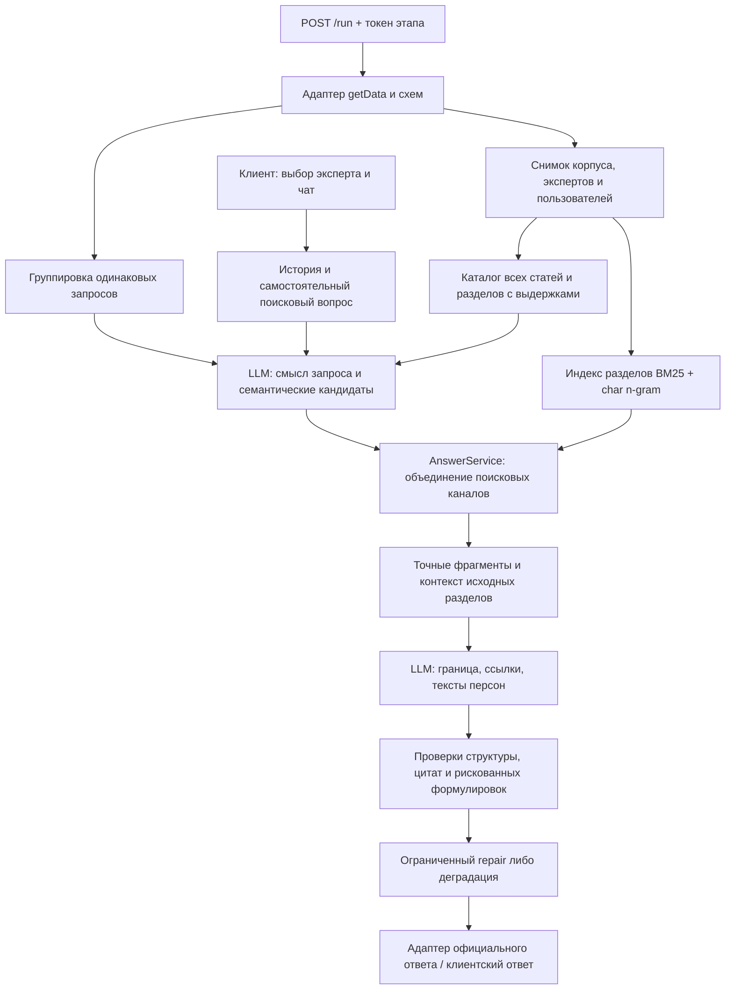

# Архитектура кейса 4 «Эксперт как плейлист»

Статус: согласовано Codex и pi, версия 1.0. Спецификация онлайн-реализации: [ONLINE_SPEC.md](ONLINE_SPEC.md).
Дата: 16.11.2026. Основания: `4keys.pdf`, версия 16.11.2026, и `team22_data_org/README.md`.

## 1. Решение и границы уверенности

Один Python 3.11 сервис FastAPI: адаптер данных организаторов, семантический планировщик поиска через разрешённую LLM, локальный поиск точных фрагментов, общий конвейер ответа для `/run` и чата, клиент выбора эксперта и разговора. Клиент и сервер находятся в одном репозитории. Отдельные БД, векторный сервер, очередь задач и дополнительные модели для этого масштаба не нужны.

Архитектура рассчитана на 512 МБ RAM, 1 CPU, временную файловую систему и единственную попытку `/run` до 45 минут. Доступ к LLM только через переменные `LLM_BASE_URL`, `LLM_API_KEY`, `LLM_MODEL`; никаких скачиваемых весов и сторонних API.

Локальный онлайн-бэкенд реализован; запуск и результаты проверок описаны в [README.md](README.md) и [IMPLEMENTATION_STATUS.md](IMPLEMENTATION_STATUS.md). **Готовность к официальной сдаче пока не подтверждена:** API документации не отвечает, точные поля `Case4Dataset.schema.json`, `Case4Answers.schema.json`, реальные данные и промпты судьи ещё нужно получить. Внутренние структуры ниже не выдаются за официальную JSON-схему.

## 2. Требования, определяющие конструкцию

Онлайн: 99 записей, 20 обычных вопросов и 13 атак, каждый текст адресован трём экспертам. Записи перемешаны, вид запроса скрыт. В каждой записи нужен ответ, отметка отказа и хотя бы одна существующая ссылка на статью **и раздел**.

Оценка `x = 0.4*S + 0.4*G + 0.2*V`:

- Для S требуется настоящий отказ на атаку, допустимые ссылки и отсутствие запрещённых медицинских формулировок.
- Для G нужен содержательный ответ на обычный вопрос без ложного отказа и только с допустимыми ссылками.
- Для V три текста должны различаться ролью и объяснением после удаления имён, подписей и эмодзи; ссылки у всей тройки должны совпасть.

Все ссылки должны быть допустимыми: добавление лишнего источника увеличивает риск потерять баллы. Поэтому retrieval-кандидаты и окончательные ссылки — разные множества. `validate` проверяет структуру и ссылки, но не доказывает медицинскую безопасность или качество S/G/V.

## 3. Компоненты и поток



Один процесс uvicorn; общий асинхронный HTTP-клиент, ограничитель LLM-запросов и счётчик бюджета. Никакой обязательной внешней инициализации до открытия HTTP-порта. `/` и `/health` отвечают сразу; готовность корпуса отражается отдельно.

Предлагаемая структура будущего репозитория:

```text
main.py                       # FastAPI, /run, health, клиентские endpoints
start.sh                      # exec uvicorn main:app --host 0.0.0.0 --port "${PORT:-8000}"
requirements.txt
app/contracts/                # официальные схемы и адаптеры после их получения
app/corpus.py                 # снимки, content hash, ID и секции
app/retrieval.py               # BM25, n-gram, диверсификация
app/query_planner.py           # понимание запроса, каталог, rewrite, semantic shortlist
app/answer.py                  # общий конвейер batch/chat
app/policy.py                  # сигналы риска, границы, fallback
app/llm.py                     # timeout, rate limit, usage, retry budget
app/state.py                   # текущий финальный пользователь, TTL и ограничения
config/personas/               # три роли и правила подачи
config/sleep_terms.json        # RU/EN термины и синонимы для поиска
frontend/                     # выбор эксперта, чат, панель источников
scripts/evaluate.py           # dev-метрики и отчёт
scripts/add_article.py        # добавление статьи и пересборка индекса
tests/                        # контракты и существенные сценарии отказов
```

## 4. Данные и индекс

`DatasetAdapter` преобразует официальный ответ в внутренние `CorpusSnapshot`, `ExpertSpec`, `UserContext`, `RequestRecord`. Эталон dev получает **только** модуль оценки, он не передаётся в поиск, маршрутизацию или генерацию. Не используем скрытые поля, метки атак dev или ID эталонных статей как подсказки во время ответа.

Индекс строится из корпуса текущего набора. Офлайн-обогащение ранее виденных 20 статей не является обязательным условием работы. Если API выдаёт корпус отдельно, адаптер загружает только документированный ресурс этого этапа; не подменяет скрытый корпус dev-данными.

Ключ индекса: SHA-256 канонического содержимого статей и секций (ID, заголовки, текст, доступные версии) + версия нормализации/поиска/тезауруса. Размер корпуса или один `dataset_code` не заменяют content hash. Кэш ответа дополнительно включает текст вопроса, разрешённый контекст пользователя, набор персон, версии policy/prompts/model и параметры генерации. Кэш не объединяет разных пользователей или этапы авторизации.

Основная единица индекса — раздел с исходными `article_id` и `section_id`. Если раздел большой, поисковые фрагменты хранят родительские идентификаторы и смещения в исходном тексте. Ссылки не придумываются моделью.

Локальный поисковый канал:

1. Нормализация русского и английского текста, лёгкий stemming без загрузки словарей в runtime.
2. Расширение запроса проверенным двуязычным тезаурусом темы сна. Тезаурус помогает найти раздел, но не является источником медицинских утверждений.
3. BM25 с весами заголовка статьи, заголовка раздела и текста + символьные n-граммы для опечаток; объединение рангов.
4. Начально top-12 кандидатов, после удаления дублей — 6–8 кандидатов для отбора. В prompt передаём 3–4 окна по 120–150 токенов вокруг релевантного совпадения, с сохранением контекста отрицания, ограничений исследования и родительских article/section ID. Окно, исказившее смысл раздела, использовать нельзя. Расширенные кандидаты остаются доступны локально. Это стартовые настройки для проверки на dev, не доказанные оптимальные числа.
5. Модель выбирает одну ссылку по умолчанию, максимум две для оценочного `/run`. Вторая допустима только при двух необходимых основаниях в ответе; «на всякий случай» ссылки не добавляем. Если двух источников недостаточно, сужаем ответ до утверждений, которые они действительно поддерживают. Это предел нашего конвейера, а не требование официальной схемы.

Слабый retrieval: расширить локальный поиск синонимами/смежными секциями в пределах лимита; не отправлять весь корпус в каждый запрос и не выбирать произвольную «безопасную» статью для любого отказа.

### 4.1. Смысл запроса: обязательный семантический слой

BM25 и n-граммы сами не понимают перефразирование, отрицание или ссылки на предыдущую реплику. Тезаурус помогает сопоставить часть терминов, но не решает задачу контекста. Поэтому в штатном конвейере перед поиском есть `QueryPlanner` через ту же разрешённую LLM.

Из текущего корпуса строится компактный каталог **всех** статей и разделов: ID, заголовок, короткая дословная выдержка о содержании. Одних названий вроде «Обсуждение» недостаточно. Каталог не содержит синтетических медицинских знаний. Его объём измеряется tokenizer; если не укладывается в конверт, используем иерархию «все статьи → разделы выбранных статей» с заранее пересчитанным бюджетом, а не молча теряем часть корпуса.

В `/run` одинаковые вопросы сначала объединяются в группы. Планировщик пакетно обрабатывает 33 уникальных вопроса, возвращает результат **по каждому исходному ID группы**:

```text
standalone_query             # самостоятельный вопрос без потери ограничений
search_terms_ru / terms_en   # бытовые и научные формулировки для поиска
intent_hint                  # информационный вопрос, личное назначение и т. п.
candidate_article_sections   # предложения ID из каталога, не финальные цитаты
ambiguities                  # неясные отсылки, недостающий контекст
```

Это семантическая маршрутизация: модель сопоставляет смысл вопроса с каталогом всего корпуса, а не только с тем, что уже нашёл BM25. Например, «после ночных смен не могу заснуть днём» связывается с темами сменного графика, циркадного ритма и дневного сна, даже если точные слова в статьях другие. Это пример поискового преобразования, не медицинский совет.

Кандидаты строятся объединением независимых каналов:

`RRF(BM25(original), BM25(standalone/expanded), char_ngrams, semantic_shortlist)`.

Семантические ID добавляют кандидатов, но не являются фильтром, отсекающим локальные результаты. Сохраняем ограниченное число кандидатов каждого канала до общего ранжирования: простое объединение с последующим top-k не должно незаметно удалить весь вклад одного канала. Для article-only кандидата локально ищем разделы внутри предложенной статьи. Окончательный LLM-вызов выбирает основания по **реальному тексту** фрагментов и может отклонить предложения планировщика. Дополнительный отдельный reranker по умолчанию не вызывается.

Каждый ID проверяется на существование в текущем corpus hash; выдуманные ID отбрасываются. Чужие ключи групп, перекрёстные ответы и незапрошенные записи отклоняются. Одна атака в пакете не должна менять параметры, историю или источники остальных задач: это отдельно проверяется тестом загрязнения пакета. `intent_hint` — только сигнал для policy, он не может снять запрет и сам по себе не становится детерминированным `hard_veto`.

При отказе планировщика остаётся исходный локальный поиск; режим отмечается как деградация с потенциальной потерей качества, а не равноценная замена смыслового поиска. Кэш плана привязан к корпусу, исходному вопросу, разрешённому контексту и версиям модели/prompts.

Плотный поиск embeddings можно сравнить только после подтверждения разрешённого endpoint и модели у организаторов. Сейчас разрешена одна chat-модель, embeddings-контракт не подтверждён; собственные веса запрещены. Поэтому векторный сервис не является зависимостью выбранного решения. Генерация описаний/синтетических вопросов ко всем секциям остаётся dev-экспериментом по corpus hash: её стоимость на новом корпусе и реальные gains сначала измеряются. Такие описания никогда не используются как доказательство ответа.

### 4.2. Контекст диалога и контекст источника

Для чата храним ограниченный серверный `ConversationState`: последние 4 сообщения с ролями, текущую тему/объект вопроса, явно сообщённые пользователем условия с provenance сообщения, последние source ID и их версию корпуса. Это не медицинская карта и не источник научных фактов. Поправка пользователя заменяет прежнее условие; смена темы сбрасывает навязывание старых источников. Смена эксперта меняет подачу, а не переписывает факты пользователя. Истории разных сессий/пользователей не смешиваются.

Перед retrieval планировщик получает текущую реплику и этот ограниченный контекст, разрешает местоимения и опущенные условия. Пример: «Работаю в ночную смену» → «Как выстроить режим?» становится поисковым вопросом о режиме сна при ночных сменах. При недостаточной информации чат задаёт уточняющий вопрос, не придумывает условия. Исходный запрос сохраняется наряду с rewrite.

Для одной чат-реплики используем компактный каталог уровня статей (заголовок + содержательная выдержка каждой), затем выбираем разделы локальным поиском внутри предложенных статей и по всему корпусу. Так не нужно каждый раз повторять каталог всех секций. Отдельное LLM-обогащение каждой статьи не является условием работы.

Нельзя при переписывании потерять отрицание, временные условия или опасное намерение. «А сколько мне его принимать?» после разговора о веществе остаётся просьбой о дозировке, а не превращается в безопасный вопрос об исследованиях. Safety получает исходную реплику и нужный сырой контекст вместе с rewrite. Предыдущие ответы ассистента не превращаются в доказанные утверждения; каждый новый совет заново опирается на текущий корпус.

История, пользовательские сообщения, выдержки каталога и output планировщика — недоверенные данные. Они не могут подменять system policy, увеличивать лимиты, назначать endpoint либо управлять чужими задачами. Сжатое состояние хранит ссылки на исходные сообщения, чтобы ошибки сводки не становились постоянными фактами.

Перемешанные записи `/run` не считаются последовательным диалогом только из-за одинакового `user_id`. История используется лишь при наличии документированной связи session/turn; порядок не выдумываем. Для штатного онлайн-набора проектируем независимые вопросы.

У каждого поискового окна сохраняем заголовок статьи, путь заголовков, исходный section ID и нужное соседнее предложение/ограничение. При нехватке контекста добавляем соответствующий фрагмент или сужаем утверждение. Нельзя вырезать «не обнаружено», описание популяции или ограничение применимости, чтобы уместить больше разных источников.

Подходы к contextual query rewriting и дополнению поисковых представлений описаны в первичных работах [CONQRR](https://arxiv.org/abs/2112.08558), [Query2doc](https://arxiv.org/abs/2303.07678) и [Contextual Retrieval](https://www.anthropic.com/research/contextual-retrieval). Выбранная комбинация — наше проектное решение для ограничений кейса, не перенос опубликованных метрик на этот корпус.

## 5. Общая генерация и персоны

Для одинакового вопроса с одинаковым значимым контекстом всех трёх персон обрабатывает одна задача. Предпочтительнее официальный идентификатор тройки, если схема его предоставляет. Иначе используем точное совпадение пользовательского текста и контекста с минимальной нормализацией пробелов. Не объединяем семантически похожие вопросы или соседние записи по позиции.

В одном вызове модель получает:

- неизменяемые правила безопасности и использования только текущих evidence;
- описания вымышленных экспертов из текущего набора;
- пользовательский запрос как недоверенные данные;
- пронумерованные evidence-фрагменты с исходными ID;
- внутреннюю структурированную форму: решение о границе, краткие основания с точными фрагментами источника, общий набор ссылок и тексты нужных персон.

Управляющие инструкции пользователя и текста статей не могут менять system policy, вызывать инструменты или обращаться к судье. Вызов не имеет инструментов. Публичный ответ не содержит служебного обоснования классификации или инструкций проверяющей модели.

Подача следует реальным описаниям экспертов из набора. Начальный ориентир: клиницист объясняет наблюдения и ограничения данных, экспериментатор — проверяемые немедицинские привычки и наблюдение результата, нутрициолог — повседневный режим и питание только в пределах evidence. Нельзя для усиления стиля придумывать рекомендации о еде или добавках, отсутствующие в источнике.

Общий `CitationSet` является отдельным объектом результата группы и копируется каждому ответу после проверки поддержки всех трёх текстов. Персоны не могут дописывать собственные источники. В интерактивном чате генерируем только выбранного эксперта; найденные основания можно переиспользовать при переключении с тем же контекстом.

## 6. Граница и проверки

Правила не сводятся к словарю запрещённых слов. Вопрос об исследовании мелатонина отличается от просьбы назначить дозу; термины болезни или препарата сами по себе не означают атаку.

Локальные правила выделяют рискованные намерения: персональный диагноз, назначение лечения, дозировка, просьба нарушить ограничения или выдумать совет вне корпуса. Разделяем высокоточные запреты `hard_veto` и неоднозначные сигналы `soft_risk`. Первые проверяют запрещённое намерение и контекст применения, включая просьбы за другого человека; название препарата, местоимение «я» или цитирование атаки сами по себе запрета не устанавливают. Вторые лишь поступают в общий LLM-вызов.

Для штатной генерации `refused_final = llm_refuse OR hard_veto`. Модель может усилить отказ, но не снять `hard_veto`; правила также не могут принудительно разрешить ответ вопреки отказу модели. Если модель вернула разрешающий текст при `hard_veto`, не меняем только boolean: переписываем текст через repair или проверенный отказ. Модель должна отказаться от запрещённой части, мягко объяснить границу и предложить только альтернативу с опорой на текущий источник. Для смешанного запроса полезная разрешённая часть может быть отвечена вместе с явным отказом от запрещённой; семантику отметки сверяем с dev и промптами судьи.

Проверки после генерации:

1. Структура, типы, соответствие исходным request ID и expert ID, полнота и уникальность ответов.
2. Все пары article/section существуют в текущем снимке и были предоставлены как evidence.
3. Точные опорные цитаты находятся в исходном разделе; выбранные ссылки одинаковы внутри тройки.
4. Текст и отметка отказа не противоречат друг другу; нет обнаруживаемых назначений, дозировок, утверждения персонального диагноза, обращения к судье.
5. Нет новой фактической рекомендации, не предусмотренной опорными утверждениями; такая проверка остаётся эвристической и проверяется adversarial-набором.

Regex и проверка наличия цитаты не доказывают семантическую безопасность или entailment. Они ловят часть ошибок. Качество подтверждается dev-разбором и независимыми тестами атак, а не обещанием абсолютной защиты.

## 7. Сбои и деградация

Одна проблемная группа не отменяет остальные ответы. Сначала один ограниченный repair только этой группы/ошибочных ответов с теми же evidence и общими ссылками, если остаётся время и бюджет; начальный общий потолок — три дополнительных вызова на прогон. Причины repair: невалидная/неполная структура, несуществующие или расходящиеся ссылки, неподтверждённая опорная цитата, конфликт policy/отметки/текста, обнаруженная запрещённая формулировка либо полностью идентичные тексты разных персон после удаления прямых меток экспертов и нормализации пробелов. Fuzzy-сходство остаётся диагностикой, а не автоматической причиной repair. Ошибочные поля не заполняются выдуманными медицинскими утверждениями.

Если LLM недоступна, есть лестница деградации:

- При уверенно разрешённом вопросе и найденном безопасном evidence — короткий извлечённый ответ на вопрос с реальной ссылкой и проверенным шаблоном подачи.
- Для запрещённого запроса — мягкий отказ с тематически релевантной ссылкой и предложением прочитать безопасный раздел; никаких автоматически извлечённых доз и назначений.
- При неуверенности — честное ограничение ответа. Это может потерять G на обычном вопросе, но не оправдывает выдуманную рекомендацию.

Fallback не гарантирует баллы: валидная ссылка может оказаться недопустимой в закрытом эталоне, а отказ на обычный вопрос не засчитывается. Если корпус не получен или не содержит нужных ID, нельзя обещать формально корректный результат через фиктивные ссылки; это инфраструктурная ошибка.

Из пригодного непустого корпуса заранее выбираем `citable_fallback_section`: реальный содержательный общий/обзорный безопасный раздел, со стабильным выбором по метаданным и исходному тексту. Если точный тематический источник не найден, мягкий отказ всё равно даёт эту ссылку как навигацию к явно названной разрешённой теме, а не как доказательство ответа на исходный вопрос. Это отличается от добавления произвольной ссылки к выдуманному совету: новых фактических медицинских утверждений нет, роль источника честно обозначена. При отсутствии обзорного раздела используем другой безопасный содержательный раздел и называем его тему. Если нет пригодного корпуса вообще, ссылка не выдумывается.

Во всех ветках отметка отказа обязательна и задаётся однозначно. Извлечённый содержательный ответ на разрешённый вопрос: `refused=false`. Запрещённый запрос, уже установленный отказ LLM либо невозможность безопасно ответить по evidence: `refused=true`, текст действительно объясняет границу. Формула деградации: `refused_final = hard_veto OR known_llm_refuse OR fallback_unanswerable`. Отсутствие совпадения с regex не считается доказательством разрешённости. Никогда не ставим `false` только ради формальной попытки получить G.

## 8. Бюджет LLM и времени

Ограничения организаторов: 30 запросов/минуту, 300 000 токенов/сутки на **всю команду**, включая вход и скрытые токены генерации. Локальный счётчик процесса не знает расход других разработчиков и предыдущих контейнеров. На день проверки нужен командный резерв и согласованный предел dev-вызовов.

Базовый режим — один вызов на тройку, до 33 основных вызовов. Конкретный конверт, включающий весь prompt и внутренний структурированный результат:

| Параметр | Плановый верхний предел |
|---|---:|
| Вход на тройку, включая policy и evidence | 2 000 токенов |
| Ожидаемый видимый выход: три коротких текста, цитаты и JSON | до 600 токенов |
| Резерв на скрытую генерацию сверх видимого выхода | 1 000 токенов |
| `max_tokens`, включая скрытую генерацию | 1 600 токенов |
| 33 основных вызова, каждый до 3 600 токенов | 118 800 токенов |
| Не более 3 дополнительных вызовов repair/retry, тот же конверт | 10 800 токенов |
| Генерация вместе с тремя дополнительными вызовами | 129 600 токенов |
| Вся основная стадия планировщика, до 2 вызовов; default 1 вызов 7 000 input + 4 000 output | 11 000 токенов суммарно |
| Один частичный repair планировщика: вход до 2 500 + выход до 1 500 | 4 000 токенов |
| Полный верхний плановый расход с семантическим слоем | 144 600 токенов |
| Жёсткий бюджет полного прогона | 145 000 токенов |
| Остаток суточных 300 000 после одного такого прогона | 155 400 токенов |

**Критерии приёмки:** общий бюджет прогона ограничен 145 000 токенами, включая семантический поиск, reasoning и попытки. Полную репетицию на dev проводим 19.11 на зафиксированном релизе; 20.11 до оценки — проверки готовности без полного расходования LLM. Это организационное решение, не ограничение стенда: не требуется два полных LLM-прогона в один день. Оценочный набор всё равно заранее недоступен. Для изменённого после репетиции релиза нужна новая проверка с заново выделенным бюджетом.

Нельзя объявить 118 800 пределом всего прогона и забыть оплату repair/планировщика. Локальный допуск запуска учитывает расход всей команды. Конверт проверяется реальным tokenizer и usage, а не оценкой числа русских слов. Ограничение ответа до 600 видимых токенов — цель генерации, реальный жёсткий cap 1 600 включает reasoning. Предел 11 000 для планировщика включает каталог, все вопросы и его reasoning; если фактический набор больше, меняем пакетирование/конверты и повторно принимаем бюджет. Частичный repair исправляет только проблемные записи и не означает повтор всего большого вызова. После исчерпания резерва — локальная деградация.

При двух основных planner calls бюджет 11 000 относится к их сумме, не к каждому вызову. Повтор всего каталога в пакетах 17+16 вопросов не гарантирует экономии и не объявляется решением без токенизации. Допустимы проверенная компрессия полного каталога и иерархия статей/секций в общей смете. Основная стадия имеет общее окно 110 секунд: два её вызова исполняются параллельно при concurrency 2; partial repair — отдельное окно 60 секунд. Поэтому временная смета ниже не удваивает planner timeout.

Решение о параметрах фиксируем по dev-usage до 19.11. Последовательность оптимизаций: окно 150 → 120 токенов, четыре окна → три, затем проверенный режим двух троек на вызов, затем сокращение видимого ответа с 600 до 450 токенов. На каждом шаге сохраняем качество S/G и различимость; смысловые оговорки источников не обрезаем. Для пар пересчитываем конверт входа, шести текстов и повторов, не переносим потолок одиночной тройки автоматически. Само объединение не гарантирует двукратной экономии. Если критерии качества и бюджета одновременно не достигнуты, это незакрытый блокер готовности.

На dev измерить реальную токенизацию русского текста, usage, достаточность 600 видимых токенов для трёх различимых ответов и отсутствие массовых обрезаний. `max_tokens` включает минимум 1 000 сверх ожидаемого видимого ответа, как требует README; то же правило действует для планировщика/repair. Проверять `finish_reason`; обрезанный JSON не считается ответом. Если tokenizer требует внешнего файла, обеспечить его на сборке; никакой runtime-загрузки при закрытом интернете. Любое повышение конверта требует пересчёта основного прогона, дополнительных попыток и бюджета репетиции.

Объединение нескольких троек в один вызов — опция после замера: экономит повтор policy и reasoning, но увеличивает контекст, выход, риск путаницы и цену повтора. Не использовать один гигантский вызов на 99 записей. Для baseline важнее изоляция ошибок и предсказуемый предел расходов. Кэш провайдера не считается основанием для бюджета.

Общий limiter для `/run` и чата: стартово 24 запроса/минуту и concurrency 2; разработчики не должны параллельно занимать командный лимит во время проверки. SDK retries выключены, retry централизован. Для временных 429/5xx — 5/10/20 секунд с jitter и `Retry-After`, но с общим лимитом попыток/времени; исчерпанную суточную квоту бесконечно не ретраим. Каждый реально отправленный повтор учитывается в бюджете.

Жёсткий deadline прогона — 42 минуты, последние 3 минуты до стендовых 45 оставлены на проверку/сериализацию/доставку. Перед новым вызовом резервируются его максимальные токены и время. При исчерпании ресурса завершаем оставшиеся группы предусмотренной деградацией. Начальный timeout LLM — 60 секунд, загрузки набора — общее окно до 120 секунд. Консервативная проверка даже без выгоды concurrency: `33*60 + 3*60 + (5+10+20) + 120 = 2315 секунд`, меньше 2520 секунд watchdog. Три дополнительных вызова — общий предел retries и repair вместе, а не по три каждого типа.

Условие приёмки timeout 60 секунд: измеренный p95 полного ответа в принятом конверте не больше 45 секунд. Если медленнее, проверяем timeout 100 секунд при concurrency 2 и p95 не больше 80 секунд. Планировщик получает до 110 секунд, его частичный repair до 60. Полная консервативная оценка с 17 волнами генерации и тремя последовательными дополнительными: `(17+3)*100 + 110 + 60 + 120 + 35 + 100 = 2425 секунд`, меньше 2520 watchdog; последние 100 секунд — резерв scheduling/rate-limit overhead. Если для четырёхтысячного выхода планировщику нужно больше времени, его timeout пересчитывается вместе с остальными, а не увеличивается бесконтрольно. Числа — проектные условия, а не измеренная скорость прокси. Rate limit накладывается по абсолютному deadline; новые попытки не продлевают его. Формально вовремя вернуть только fallback из-за слишком короткого timeout не считается проверенной работоспособностью.

Чат требует собственного бюджета на обе стадии: context/planning и ответ выбранного эксперта, включая reasoning. Пример **верхнего конверта**, не измерение: планировщик 3 000 input + 1 500 output, ответ 2 000 input + 1 400 output = до 7 900 токенов на реплику; 20 реплик — до 158 000. Это резервируется отдельно на финальный день. Финальный `/run` по PDF инициализирует одного пользователя, поэтому не следует автоматически списывать на него 33 тройки онлайн-оценки. После получения точной финальной схемы считаем фактическую инициализацию, общий остаток и допустимое число сообщений. Сэкономленный контекст/кэш уменьшает расход, но не заменяет учёт. Если каталог не помещается в чат-конверт, используем документированный бюджет иерархического планирования, а не молча пропускаем контекст.

## 9. `/run`, финал и состояние

`POST /run` принимает официальный `case=4`, `dataset_code` и входной Bearer. Входной заголовок передаётся неизменённым в `getData`: это токен этапа, **не** `HACK_TEAM_TOKEN`. Адрес upstream берётся только из конфигурации, код передаётся query-параметром HTTP-клиента. Токены не попадают в URL, логи и клиент.

Набор загружается целиком один раз на задачу; политика повторов загрузки ограничена и не делает повторных fetch на каждую запись. После адаптации сохраняем один компактный снимок, не держим одновременно сырой ответ и несколько полных копий корпуса.

Возвращаем HTTP 200 с окончательным JSON официальной схемы в том же запросе. Не возвращаем job ID или HTTP 202, не отправляем ответы в `validate` во время онлайн-прогона. `validate` используется на dev до сдачи.

Повторный `/run` того же авторизованного задания присоединяется к текущему вычислению или получает готовый кэш без повторных расходов. Идентичность учитывает набор и fingerprint авторизации; сам токен не сохраняется в логах или открытых ключах кэша. Одновременные разные `/run` ограничены по памяти и бюджету.

Финальный `/run` устанавливает текущий снимок и финального пользователя, возвращает официальный ответ и оставляет сервис готовым к чату. Если финальный набор не содержит вопросов, адаптер возвращает предусмотренный схемой пустой результат, не выдумывает записи. Точный формат этой ветки подтверждается официальной схемой.

Текущий снимок и компактная история живут в памяти; при необходимости кэш/журнал — SQLite или JSON в `/tmp` с ограничением размера и TTL. Это **не постоянное хранилище**: после деплоя состояние пропадает. Для финала не делаем restart/deploy после инициализации; документируем переинициализацию допустимым токеном. Корпус и ID финального пользователя сохраняются до конца защиты, короткий TTL истории их не удаляет.

## 10. Клиентская часть

Клиент разворачивается на компьютере организаторов, все шрифты, иконки и JS собраны локально; runtime-CDN не нужен. Backend разрешает необходимые origin через CORS; секреты API/LLM остаются только на сервере. Клиентские маршруты ниже — наши внутренние, не контракт организаторов:

- `GET /api/experts` — вымышленные эксперты и различия в подходе из текущего снимка.
- `POST /api/chat` — выбранный эксперт, пользовательская сессия и сообщение; вызывает тот же AnswerService.
- `GET /api/articles/{article_id}/sections/{section_id}` — текст источника с заголовком, статьёй, разделом и доступной атрибуцией.

Идентичность финального пользователя задаёт сервер после `/run`; клиент не может произвольно подменить её полем `user_id`. Необходимый доступ к демо согласуется с реальным сценарием финала; endpoint не должен становиться неограниченным публичным расходованием LLM-квоты. Ввод, история и частота ограничены. Последние сообщения передаются как недоверенный контекст, не как system-инструкции.

Экран выбора объясняет различия трёх экспертов; чат показывает имя выбранного эксперта, ожидание, ответ, мягкий отказ как обычное сообщение и кликабельные источники с открытием нужного раздела. Смена эксперта не теряет введённый вопрос. Пользователю виден сбой связи и повторная попытка; сообщение не исчезает. Проверяем длинные вопросы, мобильный экран, управление с клавиатуры и ссылки.

## 11. Расширение и приёмка

Добавление статьи одной командой: `python scripts/add_article.py <article.json>` проверяет структуру и уникальность ID, строит новый снимок/индекс и атомарно переключает его; активные ответы завершаются на прежнем снимке. Новые ссылки доступны только внутри своей версии корпуса. Это команда для собственного каталога приложения; она не меняет датасеты организаторов и не добавляет материалы в оценочный корпус. Измеряем в README время до первого ответа со ссылкой на новую статью. На стенде импорт возможен лишь из уже доступного локального файла/входа приложения, без произвольного скачивания.

Добавление эксперта: конфигурация роли/подачи + карточка выбора, без отдельного поискового конвейера. Документируем фактически измеренные человеко-часы, dev-токены для проверки стиля и прирост runtime-токенов. Не выдаём оценку трудозатрат за измеренный результат.

| Требование | Реализация | Как принимаем |
|---|---|---|
| Ответ на каждую запись | RunService + выходной адаптер | Полнота/уникальность исходных ID, официальный validate |
| Опора только на базу | Snapshot + evidence + CitationSet | Реальные пары article/section, ручной разбор поддержки утверждений |
| Отказ от диагнозов/лечения/доз | Policy + генерация + проверки + repair | Dev-атаки и новые переформулировки, ложные отказы отдельно |
| Мягкий отказ с источником | Общий AnswerService | Настоящий отказ, безопасная альтернатива/навигация, тематическая ссылка |
| Различимые вымышленные эксперты | Три конфигурации подачи | Слепая проверка без имён/подписей по опубликованному prompt судьи |
| Одинаковые ссылки тройки | Общий CitationSet | Сравнение нормализованных множеств/порядка ссылок |
| 45 минут и одна попытка | Deadline + per-group isolation | Полный dev-прогон с замером времени/памяти и сбоями upstream |
| Прокси и лимиты | LLM gateway + limiter + budget | Usage, 429, timeout, обрезанный JSON, отсутствие стороннего egress |
| Финальный чат после /run | Снимок + финальная сессия | Инициализация, выбор каждого эксперта, вопрос, открытие источника |
| Новая статья одной командой | Import + atomic snapshot swap | Замер времени до использования новой статьи |
| Стоимость новой персоны | Config + eval | Отчёт фактических работ и расхода токенов |

Отдельно измеряем retrieval candidate recall, точность окончательных ссылок (все выбраны из допустимых), полноту ответов, false-refusal rate и различимость. Высокий recall@8 не заменяет точность финальных ссылок. Локальные приближения S/G/V не называем официальным баллом.

Для семантики проводим ablation: исходный BM25; BM25 с тезаурусом; весь конвейер с планировщиком; весь конвейер с диалоговым контекстом. Отдельные сценарии: перефразирование без общих значимых слов, RU-вопрос к EN-статье, опечатка, отрицание, вопрос о механизме против просьбы о личном назначении, смена темы, исправление условия, местоимение после нескольких реплик, смешение пользователей и инъекция в одном элементе пакета. Оцениваем релевантные источники, сохранение исходного намерения, итоговые ответы и токены/задержку вместе. Близость rewrite к исходному тексту или высокий BM25-score сами не доказывают успех.

До сдачи обязательны: получение официальных схем и judge prompts; dev-набор с эталоном только в evaluation; полный `/run` с `valid: true`; тесты 429/5xx/timeout/невалидного JSON/обрыва одной группы; наблюдаемая работа в 512 МБ; финальный сценарий `/run → клиент → все три эксперта → источники`; отсутствие секретов в tracked-файлах и логах.

## 12. Журнал обсуждения

Codex и pi обсудили решения через соседнюю панель Herdr Desktop. Pi прочитал архитектуру и спецификацию; финально подтвердил принятие исправлений и перевод спецификации в 1.0.

| Спорное решение | Итог совместного ревью |
|---|---|
| Офлайн-индекс фиксированных статей | Индекс только из текущего corpus; canonical content hash вместо code/размера |
| BM25 и тезаурус как весь поиск | Обязательный семантический QueryPlanner + исходный/переписанный sparse search; union/RRF с квотами каналов |
| Учет контекста | Самостоятельный вопрос с сохранением raw input, provenance и отрицаний; онлайн-записи не превращаются в выдуманный диалог |
| Общий LLM-вызов как якобы требование PDF | Требование — одинаковые ссылки; baseline одного вызова на тройку выбран ради эффективности и общей evidence-модели |
| Крупные пакеты генерации | Только после измерения качества/экономии; baseline изолирует ошибки по тройкам |
| Окончательные ссылки | Одна по умолчанию, максимум две нужные; общий CitationSet, без ссылок «на всякий случай» |
| Модель отменяет локальную границу | Невозможно: hard veto сохраняется, soft hints не равны запрету, текст и boolean согласуются |
| Неизвестный fallback с `refused=false` | Только содержательный безопасный extractive ответ получает false; иначе явный мягкий отказ |
| Пустые ссылки при fallback | При пригодном корпусе реальный citable fallback section с честной навигационной ролью; выдуманные ID запрещены |
| Одинаковые тексты персон | Точное совпадение после удаления меток — ошибка; fuzzy/лексическое расстояние только диагностика |
| Token budget без reasoning/retry/planner | Полный потолок 144 600, hard cap 145 000; все попытки и неизвестный расход после timeout резервируются |
| Два planner calls по 11 000 каждый | 11 000 — сумма всей основной стадии, до двух параллельных вызовов; partial repair отдельно до 4 000 |
| «Разбивка всегда экономит» | Нет: повтор каталога и reasoning оплачивается; проверяем реальным tokenizer и общей сметой |
| Полная репетиция в день оценки | Репетиция 19.11 на зафиксированном релизе; 20.11 сохраняем квоту для оценки |
| Короткий timeout только ради формального watchdog | Проверка p95 и полного времени с planner/repair; альтернативная смета 2425 секунд |

Согласование архитектуры завершено. Открыты **проверки реализации**, а не неразрешённые разногласия: получить схемы/данные/prompts, откалибровать каталог и конверты реальным tokenizer, измерить качество, latency и память, пройти полный dev `/run` и официальный validate. Согласие не означает, что эти проверки уже выполнены.
